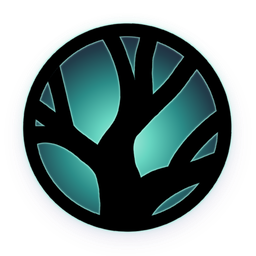
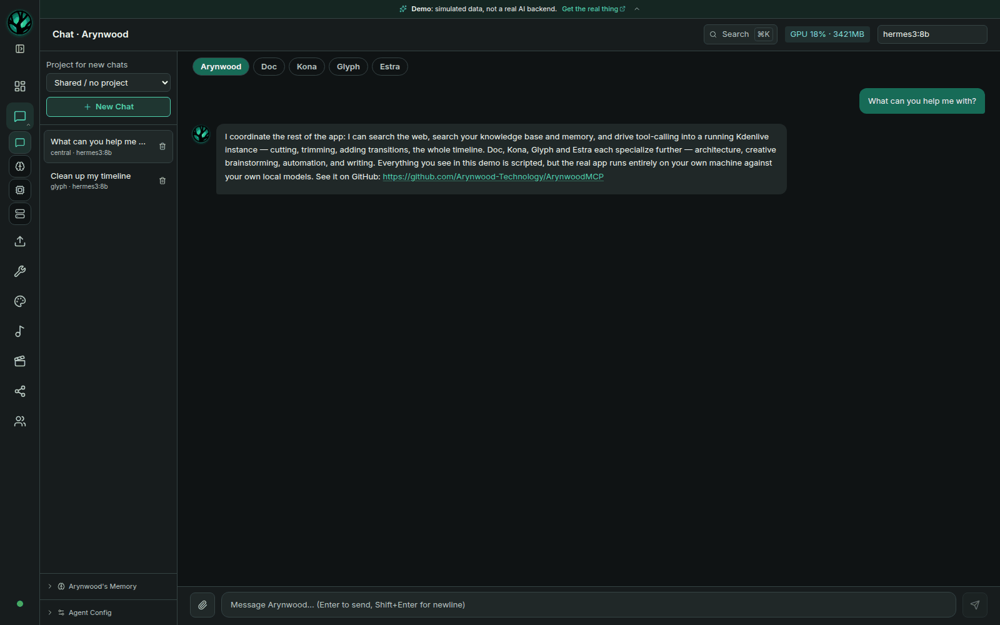

# Arynwood MCP

<p align="center"></p>

A local-first personal AI and creative workspace for Linux and Windows desktops: chat with
local Ollama models, knowledge search and memory over your own documents, a design canvas, and
Model Context Protocol (MCP) tool integrations, including Kdenlive editing through Cutroom's MCP server.

**Website:** [arynwood.com/mcp](https://arynwood.com/mcp/) (requirements, setup steps and FAQ)

[](https://github.com/Arynwood-Technology/ArynwoodMCP/actions/workflows/ci.yml)
[](https://github.com/Arynwood-Technology/ArynwoodMCP/releases/latest)
[](https://scorecard.dev/viewer/?uri=github.com/Arynwood-Technology/ArynwoodMCP)

Default model inference, memory and conversations stay on your hardware. Network features
contact outside services: web search, URL learning, model/tool downloads, social integrations,
publishing, deployment, IRC, and any remote model, image endpoint or MCP server you configure.
This is a local-first default, not an enforced offline mode. Models and supporting services
are installed separately. See [security boundaries](SECURITY.md).

**[Try the browser demo](https://arynwood-technology.github.io/ArynwoodMCP/)** — the real UI
with scripted conversations and clearly marked demo data, without a backend or live AI.



## Status

| Area | Status |
|---|---|
| Linux AppImage / .deb and Windows x64 installer, v0.5.3 (2026-10-23) | Shipped desktop alpha |
| Chat, memory, knowledge and supervised MCP tools | Alpha; external services required |
| Community page connected to your Arynwood Grove | Shipped alpha, since 0.4.9 |
| Video Studio, Music Lab and social publishing | Tier 2: works with caveats; experimental workflows |
| Stem separation, RVC and audio FX | Tier 3: early; separate sidecars, limited end-to-end validation |
| GPU scripts, LoRA and project file browser | Tier 3: source checkout only |
| Gateway | Experimental, source only, off by default; owner-only remote control |

The tiers come from the [feature review](docs/known-limitations.md), last done against 0.4.3.
[Packaged-build exclusions](docs/installation.md#features-that-dont-work-in-the-packaged-build)
list what needs a source checkout or a separate service.

## Install the packaged alpha

Download v0.5.3 from [GitHub Releases](https://github.com/Arynwood-Technology/ArynwoodMCP/releases/latest).
Linux packages target x86_64 and Ubuntu 22.04 / glibc 2.35 or newer. Windows needs x64;
the installer is unsigned and installs per user. See [platform requirements](docs/supported-platforms.md)
and [Windows setup](docs/windows.md) before installing. A GPU is optional for basic chat;
generation tools have their own requirements.

- **AppImage:** download the asset, then `chmod +x arynwood-mcp_*.AppImage` and run it.
- **Debian/Ubuntu:** download the `.deb`, then `sudo apt install ./arynwood-mcp_*.deb`.
- **Windows:** download and run the x64 installer; follow the [Windows guide](docs/windows.md).

Install [Ollama](https://ollama.com) and a model separately. Knowledge search also needs
Qdrant and an embedding model. The `.deb` uses your system's GStreamer plugins;
the [installation guide](docs/installation.md) lists the packages and first-run steps.

Verify `SHA256SUMS.txt` against the downloaded package before running it.
Build attestations were added after 0.5.3; **0.5.4 will be the first release with them**.
Published 0.5.3 packages do not have those attestations.

## Quick start

Requires Python 3.11+, Node.js 20.19+ or 22.12+, npm and Ollama.

```bash
git clone https://github.com/Arynwood-Technology/ArynwoodMCP.git
cd ArynwoodMCP
python3 -m venv venv
source venv/bin/activate
pip install -r requirements.txt
npm --prefix frontend ci
cp .env.example .env
ollama pull hermes3:8b
ollama pull nomic-embed-text
./start.sh
```

The model names are bundled examples, not recommendations. Edit the copied environment
file for your setup. The UI is at http://localhost:5180 and API at http://localhost:8010
([API reference](docs/api/README.md)).
Backend and Ollama default to loopback. See [source setup](docs/installation.md#running-from-source-current-always-available)
for configuration, knowledge services and the development desktop launcher.

### Knowledge base setup

Knowledge search needs Qdrant and the `nomic-embed-text` embedding model:
[setup steps](docs/installation.md#knowledge-base-setup).

## What's inside

- **Dashboard and navigation:** service health, command palette and status drawer — [feature guide](docs/features.md#getting-around).
- **Chat, knowledge and memory:** personas, document retrieval and remembered facts — [guide](docs/guide.md).
- **MCP tools:** supervised calls, including Kdenlive integration — [feature guide](docs/features.md#mcp-tool-servers).
- **Models and servers:** local and remote endpoints — [endpoint guide](docs/endpoints.md).
- **Community:** your Grove's spaces inside the desktop app — [Community guide](docs/community.md).
- **Design and GPU tools:** canvas and separately installed generators — [feature guide](docs/features.md#design-center).
- **Studio and Music Lab:** sidecars and maturity caveats — [Studio setup](docs/studio.md).
- **Video Studio:** editing and captions, Tier 2 — [feature guide](docs/features.md#video-studio).
- **Social and publishing:** credentials, external actions and caveats — [feature guide](docs/features.md#social-media).
- **Gateway:** experimental owner-only remote control — [gateway guide](docs/gateway.md).
- **Architecture, database and ports:** [architecture](docs/architecture.md).

[All documentation and release notes](docs/README.md).

## History

Arynwood MCP grew out of ArynCore, started in June 2025 and developed in private. This public
repository opened on 2026-09-10 with the first Linux desktop alpha (0.4.0), imported in a single
commit. Windows shipped in 0.4.5. The Community page shipped in 0.4.9; it connects to
[Arynwood Grove](https://github.com/Arynwood-Technology/arynwood-community), a separate service.
[History and release timeline](docs/history.md).

## How this is built

I design the architecture, choose the scope, review changes, run tests, ship releases and
operate the servers. Claude Code and Codex work with me as pair programmers; some assisted
commits have co-author trailers and others do not. [How we build](https://github.com/Arynwood-Technology/.github/blob/main/HOW-WE-BUILD.md).

## Security

This is an alpha for one owner on one machine. It has no OS sandbox or enforced offline
mode. Read [SECURITY.md](SECURITY.md) for protections, known gaps and private reporting.

## License

Arynwood MCP is free software under the [GNU Affero General Public License v3.0 only](LICENSE)
(AGPL-3.0-only). You may use, study, share and change it. If you share a changed version, or run
one as a service for other people, you must offer its source under the same license. Releases up
to and including 0.5.3 shipped under an earlier source-available license.

The Arynwood tree logo and the app icons made from it (`frontend/src-tauri/icons/`,
`frontend/src-tauri/icon-source/`, `frontend/public/icon.png`, `frontend/src/assets/arynwood-tree.png`)
are artwork by Arynwood Technology. They are not covered by the code license; all rights reserved.

## Contributing

See [CONTRIBUTING.md](CONTRIBUTING.md). Report reproducible problems through
[GitHub issues](https://github.com/Arynwood-Technology/ArynwoodMCP/issues).
